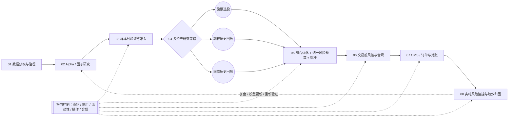

# AtlasPM — Standard Quantitative Investment Workflow

**Architecture specification with current implementation status.**

This is the intended institutional-style *research-to-execution* lifecycle. Unlike a one-pass trading diagram, risk controls are **continuous**, and hedge design is coupled to portfolio construction. Three asset research sleeves feed the same cross-asset capital/risk budget.

## End-to-end flow



> The diagram shows the target architecture. AtlasPM supports historical multi-asset research and a local, operator-approved Paper workflow. Authenticated Paper acceptance, joint hedge optimization and real-time monitoring remain open in [TODO.md](TODO.md).

## Domain directory organization

The domain packages hold the implementations. Existing `quant/` and
`selection/` import paths use lightweight aliases. See [canonical source map](CODE_LAYOUT.md).

```text
src/atlaspm/
  data/                  # Real stock market data and quote-quality code
  research/              # Real stock rankers, validations and ML studies
  strategies/equity/     # Real screening, monthly candidates and alpha gate
  strategies/options/    # Historical options and protective put replay
  strategies/bonds/      # Treasury prices, cash flows and duration replay
  risk/                  # Real risk and margin simulations
  execution/             # Offline synthetic OMS and read-only IBKR
  monitoring/            # Historical performance, audits and local UI
  quant/                 # Core portfolio/backtest + alias wrappers
  selection/             # Alias wrappers for existing imports
  portfolio/             # RESERVED; root portfolio.py shadows package
  hedging/               # Historical comparison of equity and hedge combinations
```

The unified equity engine lives in `engine/`. The local market-close and IBKR
Paper commands are documented in [the rebalance guide](quant/MARKET_CLOSE_REBALANCE.md).

## Code-to-stage mapping and completion boundary

| Stage | Existing code | Current maturity |
| --- | --- | --- |
| **01 Data** | `data/historical_universe.py`, `data/stock_fundamentals_import.py`, `market_close.py` | Dated membership, filings and price audit. Complete IPO and delisting coverage is pending. |
| **02 Alpha** | `research/ai_stock_ranker_v2.py`, `strategies/equity/consensus_20_screener.py` | Stock research with unverified out-of-sample alpha. |
| **03 Validation** | `research/stock_walkforward.py`, `research/stock_comparison.py` | Costed comparisons with a separate holdout. Broader independent tests remain open. |
| **04 Asset sleeves** | `strategies/equity/`, `strategies/options/`, `strategies/bonds/` | Equity screening, protective puts and historical Treasury replay. |
| **05 Portfolio + hedging** | `engine/stock_allocation.py`, `risk/risk_budget.py`, `hedging/multiasset_hedge.py` | Equity allocation and historical hedge comparison. Joint cross-asset optimization is pending. |
| **06 Pretrade** | `rebalance_workbench.py`, `ibkr_whatif.py`, `ibkr_next_day.py` | Draft generation, Paper estimates and next-session rechecks. |
| **07 OMS + reconciliation** | `execution/paper_oms.py`, `ibkr_paper_orders.py`, `paper_order_journal.py` | Synthetic OMS and operator-approved IBKR Paper path with authenticated acceptance pending. |
| **08 Monitor + feedback** | `monitoring/performance.py`, `monitoring/ibkr_dashboard.py` | Offline snapshots and risk review. |

Note: **RiskNet is primarily a risk model**, not proof of stock-selection Alpha. Candidate scores are ordinal model output and are not calibrated expected returns.

### Independent gates (all must be evidenced before a production system)

1. Validate historical **point-in-time instruments** (IPOs, delistings, symbol changes), data validity and corporate actions; check quote liquidity and latency.
2. Verify Alpha robustness with a **frozen model**, genuinely unseen dates, baselines and statistical uncertainty.
3. Evaluate a **cost-aware**, capacity-limited, survivorship-aware portfolio/backtest with stress and tail-loss scenarios.
4. Independently validate risk controls, counterparty/broker fields, financing rates, buying power, permissions and operator approval.
5. Test isolated **paper** execution, cancellations, partial fills, idempotency, post-fill positions, reconciliation and kill switches.

The existing `alpha_eligibility` module is only a research candidate allowlist. It is **never** a trade authorization or a reason to block exits/hedges that reduce risk.

### How to inspect the architecture without any market data

```powershell
.\.venv\Scripts\python.exe -m atlaspm.framework --format json
.\.venv\Scripts\python.exe -m atlaspm.framework --format mermaid
.\.venv\Scripts\python.exe -m unittest discover -s tests -p test_standard_quant_workflow.py -v
```

This command prints an independently testable **machine-readable registry**; it never loads your `local_data/`, broker data, credentials, or model weights, and it never authorizes positions or orders.

## Financial design principles

- **Separate sleeves:** stocks use factor/rank research; options require implied/realized vol, Greeks and contract microstructure; bonds require issuer, credit, yield-curve, duration and convexity data.
- **Unified portfolio risk:** budget correlated economic exposure rather than naively treating option notional as equity weight; consider delta, vega, duration, beta, financing, liquidity and margin.
- **Joint hedging:** protective puts, index futures and interest-rate hedges are optional *portfolio decisions*, sized and costed alongside holdings, never tacked on after orders.
- **Research/production separation:** historical backtests do not imply live execution. Production-grade feeds, broker authentication, idempotent OMS, audit logs and human oversight remain independent projects.
- **Feedback loop:** monitor performance, factor/cost drift, partial fills and risk anomalies; request a **new** model/strategy validation before any production replacement.

## Next development checkpoints

See [TODO.md](TODO.md) for the remaining data coverage, strategy research, deployment and Paper acceptance work.

Machine-readable source of truth: `src/atlaspm/framework/workflow.py`; run `python -m atlaspm.framework --format mermaid` to print an automatically derived diagram.
