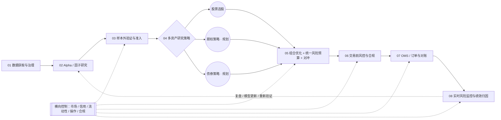

# AtlasPM — Standard Quantitative Investment Workflow

**Architecture specification, not a claim that AtlasPM already runs every stage.**

This is the intended institutional-style *research-to-execution* lifecycle. Unlike a one-pass trading diagram, risk controls are **continuous**, and hedge design is coupled to portfolio construction. Three asset research sleeves feed the same cross-asset capital/risk budget.

## End-to-end flow



> Diagram nodes describe a **target architecture**. Alpha research, basic risk modeling and simulated OMS already exist; option/bond selection, unified cross-asset hedge optimization, broker paper adapters and real-time risk monitoring remain incomplete or not implemented.

## Code-to-stage mapping and completion boundary

| Stage | Existing code | Current maturity |
| --- | --- | --- |
| **01 Data** | `selection/us_market_universe.py`, `us_market_quality.py`, `corporate_action_reconciliation.py` | Partial research; point-in-time delistings missing |
| **02 Alpha** | `selection/ai_stock_ranker_v2.py`, `consensus_20_screener.py` | Research, **not proven profitable** |
| **03 Validation** | `selection/stock_walkforward.py`, `alpha_eligibility.py`; `quant/atlas_robustness_audit.py` | Partial; truly new holdout and cost validation needed |
| **04 Asset sleeves** | `selection/monthly_stock_selection.py` (equities only) | Equities experimental; **options and bonds planned** |
| **05 Portfolio + hedging** | `quant/mean_variance.py`, `risk_budget.py`, `ibkr_multiasset_budget.py`, `atlas_risknet.py`, `atlas_fusionnet.py` | Offline risk research; unified hedge optimizer planned |
| **06 Pretrade** | `quant/institutional_gate.py`, `institutional_batch.py` | Synthetic-only / no broker-authorized purchasing power |
| **07 OMS + reconciliation** | `quant/paper_oms.py`, `broker_reconcile.py` | Synthetic replay only, **no broker order submission** |
| **08 Monitor + feedback** | `quant/performance.py`, `ibkr_dashboard.py` | Offline snapshots; not real-time portfolio supervision |

Note: **RiskNet is primarily a risk model**, not proof of stock-selection Alpha. Candidate scores are ordinal model output and are not calibrated expected returns.

### Independent gates (all must be evidenced before a production system)

1. Validate historical **point-in-time instruments** (IPOs, delistings, symbol changes), data validity and corporate actions; check quote liquidity and latency.
2. Verify Alpha robustness with a **frozen model**, genuinely unseen dates, baselines and statistical uncertainty.
3. Evaluate a **cost-aware**, capacity-limited, survivorship-aware portfolio/backtest with stress and tail-loss scenarios.
4. Independently validate risk controls, counterparty/broker fields, financing rates, buying power, permissions and operator approval.
5. Test isolated **paper** execution, cancellations, partial fills, idempotency, post-fill positions, reconciliation and kill switches.

The existing `alpha_eligibility` module is only a research candidate allowlist. It is **never** a trade authorization or a reason to block exits/hedges that reduce risk.

### How to inspect the architecture without any market data

```powershell
cd C:\Users\Kevin\Desktop\AtlasPM
git pull --ff-only origin main
.\.venv\Scripts\python.exe -m atlaspm.framework --format json
.\.venv\Scripts\python.exe -m atlaspm.framework --format mermaid
.\.venv\Scripts\python.exe -m unittest tests.test_standard_quant_workflow -v
```

This command prints an independently testable **machine-readable registry**; it never loads your `local_data/`, broker data, credentials, or model weights, and it never authorizes positions or orders.

## Financial design principles

- **Separate sleeves:** stocks use factor/rank research; options require implied/realized vol, Greeks and contract microstructure; bonds require issuer, credit, yield-curve, duration and convexity data.
- **Unified portfolio risk:** budget correlated economic exposure rather than naively treating option notional as equity weight; consider delta, vega, duration, beta, financing, liquidity and margin.
- **Joint hedging:** protective puts, index futures and interest-rate hedges are optional *portfolio decisions*, sized and costed alongside holdings, never tacked on after orders.
- **Research/production separation:** historical backtests do not imply live execution. Production-grade feeds, broker authentication, idempotent OMS, audit logs and human oversight remain independent projects.
- **Feedback loop:** monitor performance, factor/cost drift, partial fills and risk anomalies; request a **new** model/strategy validation before any production replacement.

## Next development checkpoints

1. Introduce verified historical PIT US equity universe and cross-asset reference-data contracts.
2. Improve V2 stock ranking relative to the unambiguous momentum baseline; reject tied/negative-IC models.
3. Develop option and bond *research-only* price/risk adapters with reproducible synthetic fixtures.
4. Create a no-orders unified risk exposure schema and portfolio plus hedge research preview.
5. Add costed paper simulation and independent reconciled risk controls before considering any real broker integration.

Machine-readable source of truth: `src/atlaspm/framework/workflow.py`; run `python -m atlaspm.framework --format mermaid` to print an automatically derived diagram.
