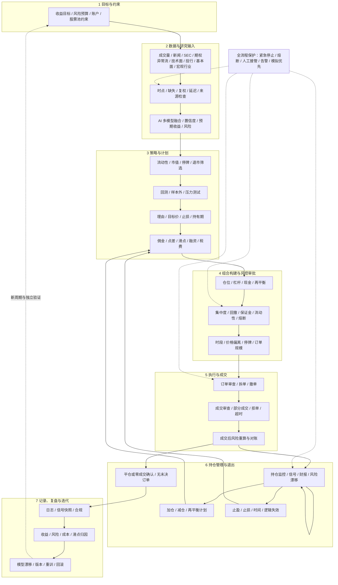

# AtlasPM — 完整交易生命周期 V1

This is the seven-phase integration framework for the supplied trading workflow.
It complements the existing eight-stage multi-asset research registry
([QUANT_WORKFLOW.md](QUANT_WORKFLOW.md)); no legacy API or strategy is replaced.

## Lifecycle



## Canonical domain boundaries

| Phase | Reuse existing code | Remaining integration work |
| --- | --- | --- |
| 1 Mandate | engine.models, risk.risk_budget | Versioned mandate schema, account policy |
| 2 Inputs | data, research | News, analyst research and unusual options flow adapters; point-in-time provenance; calibrated multi-model fusion |
| 3 Plan | strategies.equity, research, engine.replay | Costed trade-plan contract, independent validation evidence |
| 4 Allocation and risk | engine.unified, risk, execution.institutional_gate | Unified handoff, current broker snapshot and preflight approval |
| 5 Execution | execution.paper_oms, existing IBKR Paper modules | Authenticated Paper acceptance, partial fill, unknown order and retry reconciliation |
| 6 Positions and exits | risk.ibkr_margin_monitor, close_drafts, execution.institutional_rebalance | Continuous position monitor, independent exit policies and flat confirmation |
| 7 Review | monitoring, research.training_experiment | Attribution, immutable model registry handoff and independent promotion |

All names are under atlaspm. Existing code references are integration
candidates, **not** proof that a provider is connected or a stage is production-ready.

## Offline review API

```powershell
$py = ".\.venv\Scripts\python.exe"
& $py -m atlaspm.framework.trading_lifecycle
& $py -m unittest discover -s tests -p test_trading_lifecycle.py -v
```

```python
from atlaspm.framework.trading_lifecycle import LifecycleReview, Receipt, Step

review = LifecycleReview("synthetic-example")
review = review.record(Receipt(Step.MANDATE, "fixture-mandate", "reviewed"))
review = review.record(Receipt(Step.INPUTS, "fixture-inputs", "reviewed"))
review = review.record(Receipt(Step.QUALITY, "fixture-quality", "blocked", "stale quotes"))
assert review.status == "blocked"
assert not review.report()["trade_authorized"]
```

The 21 review steps and permitted transitions live in
`src/atlaspm/framework/trading_lifecycle.py`. Receipts are immutable and
require a distinct evidence reference. They are **declared** evidence only;
no actual evidence content, timestamps, signatures, fills or positions are
verified. The caller must use synthetic or independently verified local records.
A block terminates this review, not the management of real positions.

## Safety and implementation boundaries

- This is an offline review state machine, not an order executor, risk engine,
  scheduler, persistent OMS, or model deployment service. Its declared control
  list is a requirement inventory, not implemented emergency-stop functionality.
- Every adjustment/exit review revisits costs, allocation, risk and preflight.
  Before an operational adapter exists, distinguish increase-risk from
  reduce-only actions; increasing risk requires current independent alpha
  eligibility and exits must never depend on entry-alpha eligibility.
- Real emergency reduction and cancellation must have a separate independently
  validated operational route; a blocked review must never strand risk.
- Flat reconciliation requires actual broker position and outstanding-order
  verification before operational completion; the offline API does not perform it.
- Existing manually confirmed IBKR Paper behavior is untouched. There is no
  auto-submit, live permission, automatic model promotion or live scale-up.
- Implement actual controls and provider adapters in canonical domains, not
  duplicate algorithms under framework/. Add independent acceptance tests before
  wiring any operational handoff. Keep all private inputs and artifacts local.
